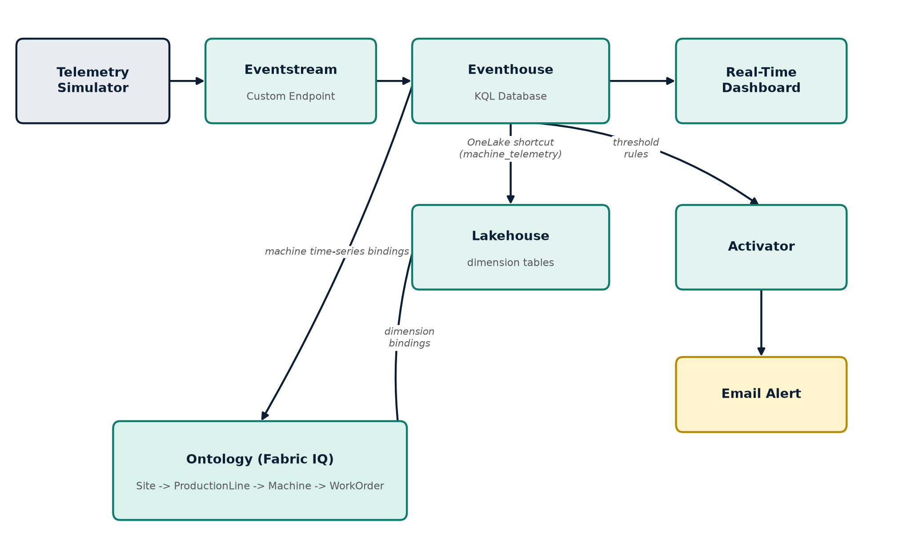
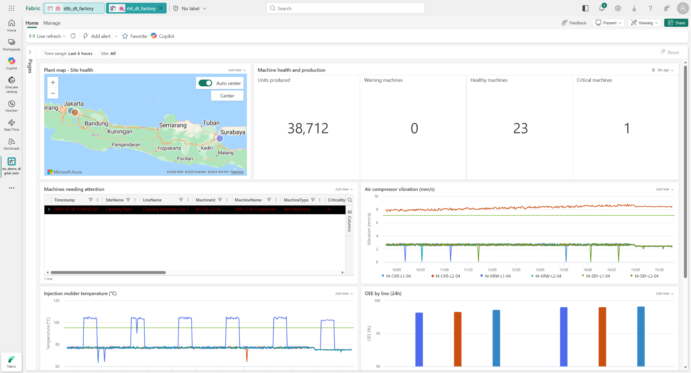

# Factory Digital Twin Demo — Microsoft Fabric

A solo, end-to-end Digital Twin demo for a fictitious manufacturer (**PT Nusantara Manufaktur** — 3 plants, 6 production lines, 24 machines), built entirely on **Microsoft Fabric**: real-time telemetry ingestion, a KQL-powered digital twin model, an operational dashboard, and automated alerting — all on one data & AI platform.





## What's inside

| Fabric component | Role |
| --- | --- |
| **Lakehouse** | Master data (sites, lines, machines, work orders) + unified access to telemetry via a OneLake shortcut |
| **Eventhouse (KQL Database)** | Telemetry history + live stream; health/score/anomaly/OEE functions in KQL |
| **Eventstream** | Real-time ingestion from the telemetry simulator |
| **Ontology (Fabric IQ)** | The digital twin model: `Site -> ProductionLine -> Machine -> WorkOrder` |
| **Real-Time Dashboard** | Plant map, machine status, vibration/temperature trends, OEE per line |
| **Activator** | Automated email alerts on vibration/temperature threshold breaches |

Full write-up, architecture diagram, and a step-by-step build guide: **[docs/Fabric-Digital-Twin-Demo-Documentation.docx](docs/Fabric-Digital-Twin-Demo-Documentation.docx)**.

## Demo video

A ~77s walkthrough (Indonesian narration + burned-in subtitles): **[video/demo-digital-twin-fabric.mp4](video/demo-digital-twin-fabric.mp4)**.

## Repository layout

```
data/          Synthetic master data (sites, lines, machines) and anomaly scenario anchors
kql/           Eventhouse schema, dimension, history, and KQL function scripts
definitions/   Exported Fabric item definitions (Dashboard, Ontology TMDL, Activator rules)
scripts/       Python build scripts (one per component) + the shared fabric_api.py REST helper
simulator/     The live telemetry simulator and its operational PowerShell scripts
video/         The recorded demo video, subtitles, and the Playwright-based recorder
docs/          Full documentation (Word) in English and Indonesian
ids.example.json   Template for ids.json (the build scripts create the real one for you)
```

## Running it yourself

This repo uses placeholder values (`<WORKSPACE_ID>`, `<TENANT_ID>`, `<your-cluster>.kusto.fabric.microsoft.com`, etc.) in place of this demo's real tenant/workspace identifiers — you'll get your own when you build it in your own Fabric capacity. See **section 4 (Prerequisites)** and **section 5 (Step-by-Step Build Guide)** of the documentation for the full walkthrough; in short:

1. Create a Fabric workspace on an active capacity (F2+) and note its `workspaceId`/`capacityId`.
2. Run the build scripts in `scripts/` in order (`gen_master_data.py` -> `build_lakehouse.py` -> `build_eventhouse.py` -> `build_eventstream.py` -> `build_ontology.py` -> `build_dashboard.py` -> `build_activator.py`); each one reads/writes `ids.json` so later scripts can reference earlier items.
3. Grab your own Eventstream Custom Endpoint connection string and store it locally (never commit it — see `.gitignore`), then run the simulator in `simulator/`.

## Disclaimer

All data — the company name, plants, machines, and sensor history — is synthetic and generated for this demo. It is not customer or production data. Tenant-specific identifiers in this repository have been replaced with placeholders.
