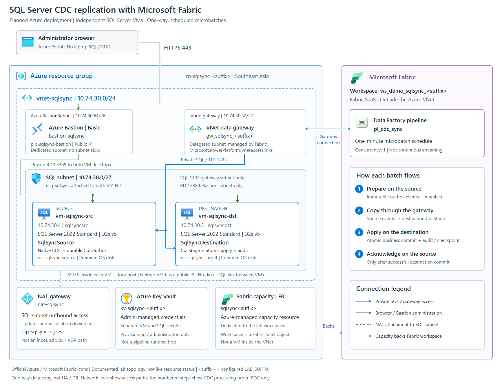

# SQL Server CDC Replication with Microsoft Fabric Pipeline

A one-way synchronization lab between **two independent SQL Server 2022 Standard instances on Azure VMs**, using native SQL Server Change Data Capture (CDC) and Microsoft Fabric Data Factory Pipeline.

The scenario is post-migration replication: a customer moving SQL Server from AWS to Azure VMs needs a separately queryable data copy, previously maintained using AWS Database Migration Service (DMS).

> **Synthetic-data lab/POC, not a production-ready replication service.** This project does not migrate an AWS database, replace every DMS capability, or provide HA/DR, automatic failover, or a latency SLA.

This README consolidates the build, exercises, and operating procedures, checked against the supplied scripts.

## Choose a learning path

| Starting point | Procedure |
| --- | --- |
| New isolated environment | Complete prerequisites and build steps 1–5, then choose either the interactive labs or the fresh-lab automation sequence. |
| Existing demonstration | Use its original configured project folder and deployment state. Start with the operating runbook and interactive labs; choose unused generator rounds. Do not provision or reinstall it. |
| Operator or trainer | Review scheduling, reconciliation, shutdown/resume, cost control, production boundaries, and the trainer checklist. |

Do not mix interactive mutations with the deterministic automation sequence. The latter reserves rounds 1, 2, and 3 and a one-time ordinary-DML example. A copied, unconfigured source package is not an operational replacement for the original deployment folder.

## Solution and data flow

This is **custom CDC orchestration**, not native Fabric CDC Copy Job configuration. Fabric transports staged CDC events; stored procedures implement the replication protocol.

| Component | Lab implementation |
| --- | --- |
| Source | `vm-sqlsync-src`, database `SqlSyncSource`, private SQL address `10.74.30.4,1433` |
| Destination | `vm-sqlsync-dst`, database `SqlSyncDestination`, private SQL address `10.74.30.5,1433` |
| Capture | Native SQL Server CDC; source SQL Server Agent must be running |
| Orchestration | `pl_cdc_sync`, one synchronization run at a time |
| Transport | SQL Server Copy Activity through a Fabric VNet Data Gateway |
| Apply | Destination stored procedure with transactional business changes and durable audit |
| Cadence | One-minute scheduled microbatches, not streaming or guaranteed one-minute lag |
| Infrastructure | Two SQL Standard PAYG VMs, dedicated Fabric F8, VNet, gateway, Key Vault, NAT, and Bastion Basic |

### Architecture and network topology

The diagram shows the **planned lab deployment** defined in [deploy.py](deploy.py) and the CDC orchestration in [fabric.py](fabric.py), not a live Azure inventory. `<suffix>` represents the configured `LAB_SUFFIX`; the region shown is the script's default, Southeast Asia.



[Open full-size PNG](diagrams/sql-server-cdc-topology.png) · [Open scalable SVG](diagrams/sql-server-cdc-topology.svg)

- **Azure boundary:** `rg-sqlsync-<suffix>` contains the VNet and supporting Azure resources. `vnet-sqlsync` (`10.74.30.0/24`) has separate SQL, Fabric gateway, and Bastion subnets. Both VMs run SQL Server 2022 Standard on Windows Server 2022 and have **no public IP**.
- **Blue — data access:** Fabric connects through `gw_sqlsync_<suffix>` to **both** private SQL addresses over TLS/TCP 1433. The gateway subnet is delegated to `Microsoft.PowerPlatform/vnetaccesslinks`; the network symbol represents that VNet integration, **not an Azure VPN gateway**. There is no direct SQL connection or linked server between the VMs.
- **Green — administration:** the administrator uses HTTPS 443 to Bastion, then private RDP 3389 to each VM. SSMS runs inside the VM and connects to `localhost`. `nsg-sqlsync` is attached to **both VM NICs, not the SQL subnet**, allowing SQL from the gateway subnet and RDP from the Bastion subnet only.
- **Supporting resources:** NAT is attached to the SQL subnet for outbound downloads/updates, not inbound SQL access. Key Vault holds administrative credentials; it is **not a pipeline runtime data-flow hop**.
- **Fabric boundary:** the workspace and pipeline are SaaS objects outside the VNet. The dedicated F8 capacity is an Azure resource backing the workspace, not a VM in the VNet. Network lines show access paths; the numbered steps show the one-way CDC processing order.

Icons are from Microsoft's official [Azure Architecture Icons](https://learn.microsoft.com/en-us/azure/architecture/icons/) and [Microsoft Fabric Icons](https://learn.microsoft.com/en-us/fabric/fundamentals/icons), used for architectural documentation. The layout is project-specific, not a Microsoft-certified reference architecture. Both assets are self-contained and use relative links for GitHub Pages.

### CDC batch sequence

Each batch follows this order:

1. **Prepare:** source `dbo.PrepareCdcBatch` creates an immutable manifest and `dbo.CdcOutbox` events, or returns the same pending batch on retry.
2. **Copy:** Fabric upserts those events into destination `dbo.CdcStage`, keyed by `(BatchId, EventNo)`.
3. **Apply:** destination `dbo.ApplyCdcBatch` commits business changes, event audit, manifest, and checkpoint in one transaction.
4. **Acknowledge:** source `dbo.AcknowledgeCdcBatch` advances the source checkpoint only after successful destination apply.

The Copy upsert targets **event staging**, not business tables. Replaying an applied batch validates the manifest and exact event bytes, then updates replay audit without repeating business DML. Empty batches also complete the protocol.

**Trust boundary:** the source cannot independently query the destination to prove a commit. Fabric success dependencies and restricted Acknowledge permissions enforce that ordering. Never acknowledge after Copy alone, bypass an unknown apply outcome, or edit checkpoints/outbox/staging/audit to force progress. No linked server or cross-server SQL query is used.

### Sample tables and keyless behavior

The fixed business schema is defined in [sql/schema.sql](sql/schema.sql).

| Table | Key design | Demonstrated changes |
| --- | --- | --- |
| `Customers` | Primary key `CustomerId` | Insert, update, delete |
| `Products` | No primary key; unique index on `SKU` | Insert, update, delete |
| `LegacyBalances` | No primary/unique key; identical duplicates allowed | Insert, update, delete exactly one duplicate |
| `EventLog` | No primary/unique key; append-only | Insert |

CDC uses `supports_net_changes=0` and `all update old`. Operation 1 (delete) and operation 3 (update before-image) each remove exactly one matching full row; operation 2 (insert) and operation 4 (update after-image) each insert one typed row. Full-row UTF-16 byte comparison preserves NULL, case, trailing spaces, Unicode, and duplicate multiplicity.

Keyless support is specific to this implementation. Do not assume native Fabric Copy Job has the same semantics.

## Project files

| File | Purpose |
| --- | --- |
| [START-HERE.txt](START-HERE.txt) | Initial guidance, desktop access, networking, and costs |
| [Topology PNG](diagrams/sql-server-cdc-topology.png), [topology SVG](diagrams/sql-server-cdc-topology.svg) | Planned Azure/Fabric architecture with official Microsoft icons; keep both assets when publishing this README |
| [requirements.txt](requirements.txt) | Python dependencies |
| [deploy.py](deploy.py) | Azure provisioning, Fabric workspace/gateway, VM administration, and deployment state |
| [configure-sql.ps1](configure-sql.ps1) | SQL Agent, TCP, encryption, and login configuration |
| [configure-desktop.ps1](configure-desktop.ps1) | SSMS installation/reuse, restricted NLA RDP, and desktop shortcuts |
| [invoke-sql.ps1](invoke-sql.ps1) | Execute line-only `GO` batches over one local SQL connection |
| [verify-transport.ps1](verify-transport.ps1) | Verify server-enforced TLS on a TCP SQL connection |
| [install.py](install.py) | Ordered SQL installation, scoped grants, and source baseline preparation |
| [fabric.py](fabric.py) | Connections, pipeline definitions, runs, evidence, and scheduling |
| [exercise.py](exercise.py) | Fresh-lab manual recovery, ordinary-DML, and actual-schedule exercises |
| [inspect-source.sql](inspect-source.sql), [inspect-target.sql](inspect-target.sql) | Read-only identity, data, keys, and replication status inspection |
| [normal-writes.sql](normal-writes.sql) | One-time ordinary keyless source DML; changes business data |
| [capture-barrier.sql](capture-barrier.sql) | Write a marker and wait for capture; not read-only and does not synchronize data |
| [sql/contract.txt](sql/contract.txt) | Procedure interfaces, invariants, permissions, limits, and recovery contract |
| [sql/source.sql](sql/source.sql), [sql/target.sql](sql/target.sql) | Source CDC/outbox/control and destination staging/apply/audit |
| [sql/schema.sql](sql/schema.sql) | Shared schema assertions, row images, and snapshot envelope |
| [sql/initialize.sql](sql/initialize.sql), [sql/demo-changes.sql](sql/demo-changes.sql) | Synthetic initialization and once-only generator rounds |
| [sql/validate.sql](sql/validate.sql) | Exact schema, checkpoint, and row-multiset reconciliation |
| [sql/source-tests.sql](sql/source-tests.sql), [sql/tests.sql](sql/tests.sql) | Administrator-run source and destination safety checks |

Generated files such as `deployment.json`, `infra.json`, pipeline JSON, `runs`, and result files are operational artifacts, not prerequisites shipped with a clean package. Preserve private operational state; do not publish it.

## Prerequisites

- Windows workstation, PowerShell, Python 3.11+, and Azure CLI available as `az.cmd`; Python dependencies are listed in [requirements.txt](requirements.txt).
- An approved Azure tenant/subscription and permissions for resource deployment, provider registration, Key Vault access policies/secrets, and VM Run Command.
- Fabric permissions and tenant settings for capacity/workspace administration, VNet Data Gateway, connections, pipelines, and schedules. Confirm gateway/capacity regional support before provisioning.
- VM quota, SQL marketplace-image availability, licensing approval, and budget for two SQL Standard PAYG VMs, dedicated F8, and network/storage services. Do not assume Azure Hybrid Benefit or passive-failover licensing applies.
- Isolated resource names and databases with synthetic data only. Isolation must cover the capacity, workspace, gateway, and connections, not just the resource group.
- Browser/Bastion access to the VMs, including required VM/NIC/Bastion permissions. Key Vault secret-read access is a separate authorization requirement.
- Ability to stop all external source writers during baseline and exact reconciliation. Normal CDC operation does not require applications to use a special lock protocol.

## Build a new isolated lab

> These commands **create billable resources or change data**. Obtain the owner's approval first. Run commands individually, wait for completion, inspect results, and stop at the first error. Do not paste an entire procedure unattended or run state-writing scripts concurrently.

### 1. Prepare tools, identity, and configuration

From the project folder:

```powershell
python --version
az version
python -m venv .venv
.\.venv\Scripts\python.exe -m pip install -r requirements.txt
.\.venv\Scripts\Activate.ps1
```

If PowerShell policy blocks activation, do not weaken organizational policy. Substitute `.\.venv\Scripts\python.exe` for `python` in subsequent commands.

Sign in with the intended deploying user, select the subscription, and verify the identity:

```powershell
az login --tenant "<tenant-id>"
az account set --subscription "<subscription-id>"
az account show --query "{id:id,tenantId:tenantId,user:user.name}" -o json
az ad signed-in-user show --query id -o tsv
```

Set these placeholders in your **private working copy** of [deploy.py](deploy.py):

| Setting | Required value |
| --- | --- |
| `SUB` | Selected Azure subscription ID |
| `TENANT` | Matching Microsoft Entra tenant ID |
| `USER_ID` | Object ID of the deploying user, not an application/client ID |
| `UPN` | Deploying user's sign-in name matching Azure CLI |
| `LAB_SUFFIX` | Unique lowercase letters/digits, preferably 6–10 characters, for this isolated lab |

The default identity placeholders intentionally fail the deployment guard. Keep public source parameterized; do not upload a customer-configured copy. The default region is `southeastasia`. Review all dependent settings before changing region, database names, or network addresses.

### 2. Provision Azure and install SQL objects

**New lab only, with no existing deployment state:**

```powershell
python deploy.py provision
python deploy.py status --wait
```

Before continuing, verify Azure deployment status is `Succeeded`, resource ownership/names are correct, both SQL VMs are separate, and neither VM has a public IP. The reference design uses two `Standard_D2s_v5` VMs with SQL Server 2022 Standard on Windows Server 2022 and a dedicated Fabric F8 capacity.

| Network segment | Address range and purpose |
| --- | --- |
| VNet | `10.74.30.0/24`; do not connect it to overlapping networks |
| SQL subnet | `10.74.30.0/27`; source `.4`, destination `.5` |
| Gateway subnet | `10.74.30.32/27`; delegated to `Microsoft.PowerPlatform/vnetaccesslinks` |
| AzureBastionSubnet | `10.74.30.64/26`; no attached subnet NSG in this lab |

The SQL NSG allows gateway-to-SQL TCP 1433 and Bastion-to-RDP TCP 3389, with explicit denies for other SQL/RDP sources. NAT provides outbound access; Bastion Basic has its own Standard static public IPv4. Do not expose either SQL VM directly to the internet.

Configure and install in this order:

```powershell
python deploy.py configure --role source
python deploy.py configure --role target
python install.py source
python install.py target
python deploy.py ssms --role source
python deploy.py ssms --role target
python deploy.py harden-vault
python deploy.py transport --role source
python deploy.py transport --role target
```

- Initial SQL configuration restarts the SQL service; complete it before introducing application traffic. Confirm both engines and the source SQL Server Agent are running.
- Source installation order: [source.sql](sql/source.sql), [schema.sql](sql/schema.sql), [initialize.sql](sql/initialize.sql), [demo-changes.sql](sql/demo-changes.sql), then scoped grants.
- Destination order: [target.sql](sql/target.sql), [schema.sql](sql/schema.sql), [validate.sql](sql/validate.sql), then scoped grants.
- Prefer [install.py](install.py). If executing manually, preserve database context and one connection across line-only `GO` batches; the shared schema script belongs in each corresponding database.
- `fabric_cdc` receives scoped runtime permissions, not `sysadmin` or `db_owner`. `TRUSTWORTHY` and cross-database ownership chaining remain off.
- `harden-vault` restricts the dedicated vault's secret policy to the deploying administrator; do not run it against a shared vault. Separate per-role VM and SQL passwords stay in Key Vault, not source files.
- Inspect both transport results for server-enforced encryption. The self-signed certificate exception is lab-only, not production TLS guidance.

Preserve `deployment.json` and the configured working folder. Never delete state or bypass the guard to force provisioning: new credentials may no longer match existing resources. Treat `infra.json` and generated results as private operational artifacts too.

### 3. Open both VMs through Bastion and inspect with SSMS

Fresh provisioning already includes Bastion. For an **existing deployment needing desktop access only**, use its original configuration/state and these additive commands instead of provision/configure/install:

```powershell
python deploy.py bastion
python deploy.py ssms --role source
python deploy.py ssms --role target
```

Desktop setup reuses supported SSMS installations or installs the signed official SSMS bootstrapper. It configures NLA RDP restricted to the Bastion subnet and creates inspection shortcuts; it does not reset deployment credentials or synchronized data.

1. In Azure portal, the authorized administrator opens this lab's **Key Vault > Secrets** and retrieves `source-vm-admin-password` or `target-vm-admin-password`. These are **VM passwords**, not the SQL pipeline passwords. Do not save them in screenshots or documentation.
2. Open `vm-sqlsync-src` > **Connect > Bastion**, select RDP with username/password, and sign in as `sqlsyncadmin` using the source VM password.
3. Repeat for `vm-sqlsync-dst` with its different target VM password. Confirm computer names `sqlsyncsrc` and `sqlsyncdst` and keep both browser sessions open. No laptop SQL connection, VPN, local SSMS, or RDP client is needed for this route.
4. Open SSMS from the desktop shortcut or Start menu. Choose **Database Engine**, server `localhost`, and **Windows Authentication**. The identities are the corresponding VM-local `sqlsyncadmin` users, not `fabric_cdc`.
5. For this self-signed lab certificate, use **Encryption: Mandatory** and **Trust server certificate**; do not select Strict. Production requires a trusted certificate with normal validation.
6. Select `SqlSyncSource` on source and `SqlSyncDestination` on destination. In Object Explorer, inspect the four business tables with **Select Top 1000 Rows**, not **Edit Top 200 Rows**.
7. Open the desktop **SQL Sync - Inspect.sql** shortcut or `C:\SQLSyncDemo\inspect.sql` and execute it. Local project equivalents are [inspect-source.sql](inspect-source.sql) and [inspect-target.sql](inspect-target.sql).
8. Re-run inspection after synchronization. Use the validation pipeline for exact reconciliation, not visual row counts alone. Never edit destination data or replication internals. Sign out/close both desktop sessions when finished.

### 4. Create Fabric connectivity and review the pipelines

```powershell
python deploy.py workspace
python deploy.py gateway
python fabric.py connections
python fabric.py deploy
```

The workspace is assigned to the dedicated capacity. The script may assign a reused empty workspace, but refuses to move a nonempty workspace from another capacity. Verify ownership before any reassignment. The gateway uses the delegated **gateway subnet**, not the SQL subnet.

Both connections use `VirtualNetworkGateway`, SQL Basic authentication as `fabric_cdc`, and separate source/target SQL secrets. Verify the private endpoints and database names in the solution table, gateway readiness, and connection access before baseline delivery.

| Pipeline | Purpose |
| --- | --- |
| `pl_cdc_sync` | Deliver CDC batches using Prepare, Copy, Apply, and Acknowledge |
| `pl_generate_demo_changes` | Generate one synthetic round on the source only |
| `pl_validate_replica` | Compare source snapshot with destination schema, checkpoints, and exact row multisets |
| `pl_inspect_sql_demo` | Inspect both server identities, editions, keyless-table counts, and checkpoints |

In Fabric's pipeline editor, compare the deployed definition with the generated `pl_cdc_sync.json` and [fabric.py](fabric.py):

| Ordered activity | Required behavior |
| --- | --- |
| `Prepare_CDC_batch` | Source Lookup returning `BatchId`, `FromLsn`, `ToLsn`, and `EventCount` |
| `Copy_CDC_events_to_destination` | Select only that batch from `dbo.CdcOutbox`; upsert into `dbo.CdcStage` on `(BatchId, EventNo)` |
| `Optional_failure_before_apply` | Controlled teaching failure; disabled by default |
| `Apply_batch_atomically` | Destination `dbo.ApplyCdcBatch` with the complete manifest |
| `Optional_failure_after_apply` | Controlled failure after commit; disabled by default |
| `Acknowledge_source_checkpoint` | Source `dbo.AcknowledgeCdcBatch` with the prepared `BatchId` |

All downstream activities require predecessor success. Manifest values bind to `@activity('Prepare_CDC_batch').output.firstRow.<field>`; `EventCount` is `Int32`, the other manifest parameters are `String`. Preserve 10-byte binary LSN/sequence values and Unicode `RowJson` during Copy; data truncation is disabled.

The synchronization pipeline has concurrency 1 and Copy has `parallelCopies=1`. Normal SQL/Copy activity policy uses two retries, a 30-second retry interval, and a 10-minute timeout. Both failure parameters default to `false`; never enable them on a normal schedule.

### 5. Prepare, deliver, and verify the baseline

Use the newly installed synthetic databases. Keep the schedule absent/paused and **all external source writers stopped from initialization through successful source acknowledgement**. Bootstrap is administrator-only; it is not an initial-load tool for existing customer data.

```powershell
python install.py bootstrap
python fabric.py run --pipeline pl_cdc_sync
python fabric.py run --pipeline pl_validate_replica
python fabric.py run --pipeline pl_inspect_sql_demo
```

Bootstrap seeds the demonstration once and prepares a durable outbox. The first delivery contains ten baseline events and uses the same Copy/Apply/Acknowledge protocol as subsequent CDC batches.

Verify before continuing:

- Source and destination are distinct SQL Server Standard instances with the expected database names.
- Each database has three business tables without a primary key; `Products` still has its unique SKU index.
- Both sides are bootstrapped, source has no pending batch, and their checkpoints/last batch agree after acknowledgement.
- `Compare_destination_multisets` returns `IsValid=1`/`true`; counts are `Customers=2`, `Products=2`, `LegacyBalances=5`, `EventLog=1`.

Only then may external writers resume. Keep them stopped if proceeding with the controlled exercises below. Choose **interactive labs OR fresh-lab automation**, not both on the same exercise state.

## Interactive hands-on labs

Use this path for an existing demonstration or instructor-led session. Confirm the original deployment folder and Fabric workspace. Pause an existing schedule using `python fabric.py pause`; **skip that command if no schedule exists**. Wait for queued/running jobs to finish in Fabric Monitor and keep external writers stopped throughout each controlled test.

### Lab A: observe a new source change round

1. Inspect both databases with the SSMS walkthrough or inspection pipeline.
2. Choose an unused round; repeating a round intentionally makes no new business changes. The example below uses 100 only if it has not already been used.
3. Generate source changes, wait for native CDC capture, and synchronize:

```powershell
python fabric.py run --pipeline pl_generate_demo_changes --round 100
python deploy.py sql --role source --file capture-barrier.sql
python fabric.py run --pipeline pl_cdc_sync
python fabric.py run --pipeline pl_inspect_sql_demo
```

4. In Fabric Monitor, inspect the prepared manifest, Copy `rowsCopied`, and successful Apply/Acknowledge. Re-run both SSMS inspections to observe the destination copy and duplicate counts.
5. Complete the exact reconciliation procedure below before deliberately resuming writers or an existing schedule.

The capture barrier writes a non-business marker and waits for CDC; it neither copies nor applies data. A quiet batch can have zero business events. Repeating round 100 is a useful no-op demonstration, not a way to generate another workload.

### Lab B: recover the same batch before and after commit

Keep scheduling and external writers paused. Use two further unused rounds (101 and 102 below), not rounds already used in Lab A or earlier sessions.

**Failure before destination apply:**

```powershell
python fabric.py run --pipeline pl_generate_demo_changes --round 101
python deploy.py sql --role source --file capture-barrier.sql
python fabric.py run --pipeline pl_cdc_sync --failure SimulateFailureBeforeApply
python fabric.py run --pipeline pl_cdc_sync
python fabric.py run --pipeline pl_validate_replica
```

Confirm the deliberately failed run reports `DEMO_INJECTED_FAILURE` at the expected activity, with a nonempty prepared batch. Copy may have staged rows, but destination business data/checkpoint must not have advanced for that batch. Recovery must return the **same `BatchId`, LSN range, and event count**, then apply and acknowledge normally.

**Failure after destination commit but before source acknowledgement:**

```powershell
python fabric.py run --pipeline pl_generate_demo_changes --round 102
python deploy.py sql --role source --file capture-barrier.sql
python fabric.py run --pipeline pl_cdc_sync --failure SimulateFailureAfterApply
python fabric.py run --pipeline pl_cdc_sync
python fabric.py run --pipeline pl_validate_replica
```

The destination now has the committed batch while the source still has it pending. Recovery reuses that manifest, verifies the exact committed events, increments replay audit without repeating business DML, and finally acknowledges the source. Compare the manifests in the failed and recovered runs; retain both as evidence.

The CLI treats only the explicitly requested injected failure as expected. Investigate any other failure. Never validate halfway through a pending nonempty batch, manually acknowledge it, or advance an LSN to bypass an uncertain commit.

### Lab C: ordinary DML and SQL safety checks

On a lab where the one-time example has **not** already run, with no active synchronization or external writers:

```powershell
python deploy.py sql --role source --file normal-writes.sql
python deploy.py sql --role source --file capture-barrier.sql
python fabric.py run --pipeline pl_cdc_sync
python fabric.py run --pipeline pl_validate_replica
```

[normal-writes.sql](normal-writes.sql) uses ordinary committed SQL, without application locking changes: insert two identical keyless rows, delete one, and update the remaining row. Expect five CDC images and one additional `LegacyBalances` row with balance `75.50`. Its `APP-EXTERNAL` guard rejects a second invocation; inspect the existing result on a reused lab instead of forcing a rerun.

After baseline delivery, run both safety suites **as administrator**, with source writers and pipelines stopped:

```powershell
python deploy.py sql --role source --file sql\source-tests.sql
python deploy.py sql --role target --file sql\tests.sql
python fabric.py run --pipeline pl_validate_replica
```

Source checks verify three expected failures, ordinary writer DML in rollback transactions, and unchanged durable business data (`ExpectedFailuresVerified=3`, `OrdinaryWriterDmlVerified=1`). Destination checks cover manifest/range/count errors, missing/extra staging, atomic rollback, payload/schema bounds, and exact replay/tamper detection. Successful replay testing retains replay audit updates but not duplicate business changes. Do not broaden the runtime login's privileges to run these tests.

## Fresh-lab automation alternative

Choose this **instead of interactive mutations**. Start after verified baseline, with no prior generator rounds, ordinary-DML example, external writers, or active schedule. Use this exact sequence:

```powershell
python exercise.py manual
python deploy.py sql --role source --file sql\source-tests.sql
python deploy.py sql --role target --file sql\tests.sql
python fabric.py run --pipeline pl_validate_replica
python deploy.py sql --role source --file normal-writes.sql
python deploy.py sql --role source --file capture-barrier.sql
python exercise.py normal
python exercise.py scheduled
```

- `manual` delivers/verifies baseline again if needed, inspects both servers, uses rounds 1 and 2 for the two injected failures, verifies same-batch recovery, and tests an empty batch after repeating round 2.
- `normal` requires the saved successful manual exercise and expects exactly five captured images from the one-time ordinary-DML script.
- `scheduled` creates/uses a real one-minute schedule, generates round 3, and waits for a completed non-manual run. It pauses/drains synchronization for exact validation, then **leaves the schedule enabled on success**.
- The manual script uses fixed capture waits; slow CDC can fail its nonempty-batch assertion. Inspect capture and saved evidence before choosing recovery. Do not delete exercise state or repeatedly mutate the lab to make assertions pass.
- These scripts persist progress/results and are not repeatable health checks. On failure, inspect both job and schedule state; do not assume scheduling was disabled.

Expected row counts for this exact isolated sequence:

| Checkpoint | Customers | Products | LegacyBalances | EventLog |
| --- | ---: | ---: | ---: | ---: |
| Baseline | 2 | 2 | 5 | 1 |
| Manual exercise: rounds 1 and 2 | 4 | 4 | 6 | 3 |
| One-time ordinary DML | 4 | 4 | 7 | 3 |
| Scheduled round 3 after the above | 5 | 5 | 8 | 4 |

These are scenario expectations, not locally executed test results. Additional rounds or external writers invalidate these fixed counts.

## Scheduling and exact reconciliation

After verified baseline and the desired teaching exercises, create a schedule only if one is needed and the automated sequence has not already created it:

```powershell
python fabric.py schedule
```

The service-side schedule survives closing the workstation. It starts shortly after creation, runs at a one-minute UTC interval, and ends 30 days later. Asynchronous capture, queueing, activity startup, transfer, and apply time can make actual lag longer than one minute.

For an **existing** schedule, use `python fabric.py pause` to disable future triggers and `python fabric.py resume` to enable them deliberately. Pause does not cancel active/queued jobs. Resume preserves the existing end date: **it cannot renew an expired schedule**. The `schedule` command also does not renew an existing schedule. Review/update its end date through Fabric before expecting new runs, and inspect saved state if the schedule is replaced.

### Exact reconciliation procedure

1. Disable the existing schedule, stop external writers and generators, and wait for all queued/running synchronization jobs to finish. If no schedule exists, do not invoke `pause`.
2. With writers still stopped, wait for capture and deliver outstanding events:

```powershell
python deploy.py sql --role source --file capture-barrier.sql
python fabric.py run --pipeline pl_cdc_sync
python fabric.py run --pipeline pl_inspect_sql_demo
```

3. Confirm no source batch remains pending. If recovering a pre-existing pending batch, repeat normal synchronization as needed to catch up through the captured boundary; never skip a range.
4. Keep both databases quiet while the source snapshot is read and compared at the destination:

```powershell
python fabric.py run --pipeline pl_validate_replica
```

5. Require `IsValid=1`/`true`, matching checkpoints/last batch, and exact schema/row-multiset equality. Then deliberately resume writers and, if intended and unexpired, the existing schedule.

A source snapshot compared with a concurrently changing destination is not proof of replication correctness. A guard failure requires investigation, not manual checkpoint manipulation.

### Read-only inspection and audit queries

The supplied inspection scripts can also run through administrative Run Command:

```powershell
python deploy.py sql --role source --file inspect-source.sql
python deploy.py sql --role target --file inspect-target.sql
```

In source SSMS, inspect capture configuration separately:

```sql
USE SqlSyncSource;
SELECT capture_instance, supports_net_changes
FROM cdc.change_tables
ORDER BY capture_instance;
EXEC dbo.GetReplicationStatus;
```

In either matching business database, inspect keyless multiplicity using binary row images rather than collation-based text grouping:

```sql
SELECT CONVERT(varchar(max), CONVERT(varbinary(max), RowJson), 1) AS RowBytes,
       COUNT_BIG(*) AS Copies
FROM dbo.BusinessRowImages
WHERE TableName = N'LegacyBalances'
GROUP BY CONVERT(varbinary(max), RowJson);
```

In destination SSMS, inspect committed batches and replay counts:

```sql
USE SqlSyncDestination;
SELECT TOP (10) BatchId, EventCount, InsertCount, DeleteCount, ReplayCount, AppliedAt
FROM dbo.AppliedBatches
ORDER BY AppliedAt DESC, BatchId;
EXEC dbo.GetReplicationStatus;
```

These queries are observational. The capture barrier and SQL safety suites are **not** read-only inspection queries.

## Operator runbook and cost control

Operate only the reviewed, isolated deployment with its original configured folder and `deployment.json`. Authenticate to the correct tenant/subscription first. Never copy the companion guide's reference IDs into commands or operate a shared capacity/workspace without its owner's authorization.

### Resume an existing lab

Keep the schedule disabled while restoring compute where possible. Derive resource names from local state, review them, then run each command individually:

```powershell
$s = Get-Content .\deployment.json -Raw | ConvertFrom-Json
az account set --subscription $s.subscriptionId
az account show --query "{id:id,tenantId:tenantId,user:user.name}" -o json
$cap = "/subscriptions/$($s.subscriptionId)/resourceGroups/$($s.resourceGroup)"
$cap += "/providers/Microsoft.Fabric/capacities/$($s.fabricCapacity)"
az rest --method post --url "https://management.azure.com$cap/resume?api-version=2023-11-01"
az vm start --resource-group $s.resourceGroup --name $s.servers.source.vm
az vm start --resource-group $s.resourceGroup --name $s.servers.target.vm
```

Verify the selected tenant/account matches the state before the resume/start operations. A `202 Accepted` response is not completion: wait for capacity **Active**, both VMs running, SQL services/source Agent ready, and gateway/connections available. Inspect pending batches, CDC retention continuity, and schedule expiry before synchronizing. Use normal recovery and validation; do not re-provision, reinstall, or reset state.

Open both Bastion/SSMS sessions for inspection as needed. Only after readiness and integrity checks, run `python fabric.py resume` if an existing, unexpired schedule should be active. If the outage exceeded available CDC history, stop and plan reviewed recovery/rebaseline instead.

### Pause compute between sessions

1. Stop demo generators/external writers as appropriate for the lab, pause the existing schedule, and wait for queued/running jobs to finish. If retaining the demo for later, reconcile first when practical.
2. Review the state-derived resource names and selected tenant/subscription. Deallocate the two lab VMs and suspend **only the dedicated lab capacity**:

```powershell
$s = Get-Content .\deployment.json -Raw | ConvertFrom-Json
az account set --subscription $s.subscriptionId
az account show --query "{id:id,tenantId:tenantId,user:user.name}" -o json
az vm deallocate --resource-group $s.resourceGroup --name $s.servers.source.vm
az vm deallocate --resource-group $s.resourceGroup --name $s.servers.target.vm
$cap = "/subscriptions/$($s.subscriptionId)/resourceGroups/$($s.resourceGroup)"
$cap += "/providers/Microsoft.Fabric/capacities/$($s.fabricCapacity)"
az rest --method post --url "https://management.azure.com$cap/suspend?api-version=2023-11-01"
```

3. Verify actual deallocated/suspended state in Azure and retain private deployment/exercise evidence for resumption.

Pausing a pipeline schedule alone does not stop VM or capacity billing. Deallocated VMs retain billable disks; Bastion, NAT, public IPs, and other services can continue charging. Fabric suspension can also settle accumulated smoothed usage/overages. Both SQL VMs are data-serving instances; do not assume passive licensing exemptions.

### Reduce Bastion-only costs

After signing out of both desktop sessions, an authorized owner can delete only this lab's `bastion-sqlsync` and its dedicated `pip-sqlsync-bastion` through Azure portal. This removes browser access but does not stop SQL replication. Do not delete the NAT egress IP, VNet, or SQL subnet. Retain deployment state; restore access later with the additive Bastion/SSMS commands above.

### Fully retire the lab

There is no complete teardown command in this project. Obtain explicit owner approval and inventory dependencies before deletion:

1. Disable schedules and drain all jobs; retain approved evidence/backups privately.
2. Remove only lab-owned schedules/items/connections and release the VNet gateway/subnet association. Preserve any pre-existing workspace unless its deletion is separately approved.
3. Wait for gateway/delegation dependencies to be released, then delete the reviewed isolated Azure resource group and any remaining approved tenant-side lab objects.
4. Verify cleanup and billing. Fabric workspace/connections/gateway are tenant objects; resource-group deletion alone does not guarantee their removal. Account for Key Vault soft delete and name reuse.

Never delete shared resources, remove state to bypass safeguards, or assume shutting down the local terminal stops service-side schedules.

## Troubleshooting and evidence

| Symptom | Check and safe response |
| --- | --- |
| Identity guard or provisioning refusal | Verify tenant/subscription/user settings and whether original deployment state already exists; do not disable the guard. |
| Connection or Copy failure | Check capacity/gateway readiness, subnet delegation, private SQL endpoint, SQL service/TCP 1433, database/login, scoped grants, and approved certificate configuration. Do not open SQL publicly as a workaround. |
| Generator succeeds but CDC batch is empty | Confirm the round was unused and SQL Agent/capture is healthy. Wait with the capture barrier; it cannot create new business changes for a repeated round. |
| Failure before/after apply | Inspect the pending source manifest and destination audit; recover with the normal sync pipeline and verify the same manifest. |
| Validation mismatch | Stop writers/schedule, drain capture and pending batches, then compare during a quiet window. Investigate unauthorized target edits or schema changes. |
| Oversized range or retention gap | Stop and plan reviewed recovery; retries do not split oversized ranges or restore expired CDC history. Never skip an LSN. |
| No scheduled run | Check enabled state, end date, capacity availability, queued jobs, and schedule history. Resume does not extend expiry. |
| Automated exercise fails | Preserve its state/results and actual service schedule state. The fixed manual capture wait may be insufficient; do not force reruns by deleting evidence. |

Inspect Fabric Monitor and private `runs` evidence for prepared manifests, row counts, injected failures, recovery, apply audit, and acknowledgement. Activity inputs/outputs are not secured/redacted by the lab's policy and results may contain row JSON. Treat them as sensitive, even when credentials are separately stored in Key Vault.

## Limits and production adoption

- **Fixed schema/types:** only the four sample tables with bounded `int`, `nvarchar`, `decimal(18,2)`, and `datetime2(3)` values. This is not arbitrary-table replication.
- No automatic DDL/schema evolution, general LOB/computed/identity/alias-type handling, arbitrary trigger semantics, or foreign-key dependency-graph orchestration.
- **Maximum 2,000 CDC event images and 2 MiB raw row JSON per batch.** Update before/after images count separately. An oversized LSN range fails without advancing checkpoints; no adaptive splitting/general backlog catch-up is implemented.
- Source CDC retention is configured to seven days. A retention gap needs a reviewed recovery/rebaseline plan, not checkpoint skipping.
- Outbox, staging, manifest, and audit tables have no lifecycle pruning and grow over time.
- Synthetic bootstrap is not a migration/initial-load engine for customer databases. External writes must be stopped through baseline acknowledgement.
- Exact validation requires quiescence, including capture/synchronization drain. The SQL 8 MiB snapshot guard does **not** override Fabric Lookup's 4 MB output limit, including serialization overhead; a single JSON row can exceed it. Keep the demonstration small.
- No production SLA, complete observability, failover, reverse replication, conflict resolution, or replication of server-level logins/jobs is supplied.

Before production consideration, design and test transaction-aware batching, sustained volume/backlog handling, schema coordination, suitable keys/indexes, retention/cleanup, lag/health alerting, recovery, backups, licensing, and operating ownership. Replace lab certificate trust exceptions with trusted TLS and review least privilege, secret rotation, and log/data protection.

Evaluate native Fabric Copy Job CDC separately against its current connector, key, and supported-mode requirements. For HA/DR, assess the appropriate SQL Server architecture instead: a pipeline-maintained writable data copy is not an availability group, and SQL Standard Basic Availability Groups do not provide a readable secondary substitute.

## Trainer checklist

A suggested three-hour session allocates 20 minutes to architecture, 15 to prerequisites, 60 to building, 25 to functional observation, 25 to keyless/retry semantics, and 35 to operations/production boundaries. Provisioning and installation time can vary; prebuild for a shorter workshop.

- Assign one operator per shared lab and one owner for state-changing commands.
- Confirm identity, budget, tenant settings, capacity availability, and the correct new/existing learning path before the session.
- Keep source and destination SSMS tabs visible with their different server identities.
- Explain staging upsert versus business-row apply, all-change CDC versus net changes, and duplicate multiplicity before fault injection.
- Reserve generator rounds and choose interactive or automated exercises; do not mix them.
- Finish with exact reconciliation, a reviewed schedule/compute state, and named ownership for cost control and cleanup.

## Publish to GitHub

The intended destination is the `sql_server_cdc_replication` folder in [apamungkas.github.io](https://github.com/apamungkas/apamungkas.github.io); the repository does not need renaming. Preserve this folder's file/subfolder structure so relative links and scripts work.

GitHub renders this README on the repository folder page. A website at `/sql_server_cdc_replication/` depends on the repository's existing Pages build configuration; a README alone does not guarantee that route. GitHub Pages does not execute these Python, PowerShell, SQL, or Fabric workloads.

Before **every** public upload:

1. Publish clean parameterized source only; restore deployment placeholders and avoid customer identities/data.
2. Exclude `deployment.json`, `infra.json`, inventory, run/exercise/schedule results, generated pipeline definitions containing environment IDs, transport/desktop output, database dumps, and real-environment screenshots.
3. Exclude `.venv`, `__pycache__`, `.env`, private keys/certificates, tokens/passwords, and editor configuration containing credentials.
4. Inspect every additional file/archive. A source review does not cover artifacts generated after deployment.
5. For Git, establish appropriate ignore rules before staging. **Ignore rules neither redact tracked files nor protect manual browser uploads.** Select uploads explicitly and inspect the staged/uploaded content.
6. If a credential has ever been published, revoke/rotate it first; removing it from the latest revision does not remove it from history.

## References

- [SQL Server connector in Fabric](https://learn.microsoft.com/en-us/fabric/data-factory/connector-sql-server-database-overview)
- [SQL Server Copy Activity source and destination](https://learn.microsoft.com/en-us/fabric/data-factory/connector-sql-server-copy-activity)
- [CDC in Fabric Copy Job](https://learn.microsoft.com/en-us/fabric/data-factory/cdc-copy-job)
- [Copy Job with a VNet Data Gateway](https://learn.microsoft.com/en-us/fabric/data-factory/copy-job-with-virtual-network-data-gateway)
- [Enable and disable SQL Server CDC](https://learn.microsoft.com/en-us/sql/relational-databases/track-changes/enable-and-disable-change-data-capture-sql-server?view=sql-server-ver17)
- [Fabric Lookup activity and limits](https://learn.microsoft.com/en-us/fabric/data-factory/lookup-activity)
- [Pause and resume Fabric capacity](https://learn.microsoft.com/en-us/fabric/enterprise/pause-resume)
- [Fabric capacity suspend API](https://learn.microsoft.com/en-us/rest/api/microsoftfabric/fabric-capacities/suspend?view=rest-microsoftfabric-2023-11-01)

Documentation was checked against the supplied source code. Azure/Fabric deployment, SQL mutations, and runtime exercises were **not executed** as part of this README update.
